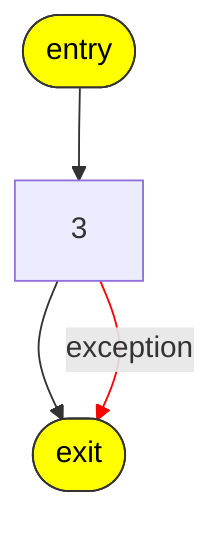

# Contract：模型 Markdown 檔 `<n>.md`

適用：`lib/dujs/markdownoutput.js` `modelMarkdown(model, level, dots)`、`outputwriter` 的寫出。對應：FR-001、FR-002、FR-005、FR-007、A1；research R2、R6。

## 1. 位置與產生時機

- 每個寫出 `<n>.graph.dot` 的模型，於同目錄寫 `<n>.md`（UTF-8、LF、結尾恰一個 `\n`）。
- 寫出順序：`<n>.graph.dot`、`<n>.dupairs.dot`、（上層）`<n>.hierarchy.dot`、（上層）`<n>.matching.json`、`<n>.md`。Markdown 由**同一份記憶體中的 DOT 字串**產生（research R1）。
- inter-page 模型：`inter-page/0.md`。

## 2. 內容（依序，區段之間一個空行）

```
# `<title>`

## Hierarchy                       ← 僅 inter-procedural／intra-page／inter-page

<renderGraph(hierarchy).markdown>  ← 未降級：```mermaid fence＋區塊＋結尾 fence；降級：mermaid-graph.md §3 的提示＋節點表＋邊表（整個取代 fence，不在 mermaid fence 內）

## Graph

<renderGraph(graph).markdown>      ← 同上

## Def-use pairs

| Variable | Def-Use pairs |
| --- | --- |
| `<var>` | `<pair>`<br/>`<pair>` |
```

- `<title>`（FR-001，`modelTitleOf`）：intra-procedural＝`intra-procedural: ` + `String(model.mainlyRelatedScope)`；其他層級＝`hierarchydot.hierarchyTitleOf(model)`（與 `.hierarchy.dot` 的 `label` 相同）。標題以 code span 包住（§3 規則）。
- 降級時整個 mermaid fence 由提示＋表格取代（不把表格放在 mermaid fence 內；與 data-model §2、tasks T009 一致，D005-A8b）。
- mermaid fence 固定三個反引號：Mermaid 區塊文字不可能含反引號（mermaid-graph.md §2.3 已實體化）。

## 3. Markdown 儲存格／行內文字規則（`codeSpan`、`cell`）

- `codeSpan(s)`：`k` = max(1, s 中最長反引號連續數 + 1)；s 首或尾為反引號或空白時，兩側各補一個空白；結果 `` `…` ``（k 個反引號）。空字串 → 空儲存格（不輸出 code span）。
- `cell(pieces)`：每個 piece 先依 `\n` 拆段，各段 `codeSpan`，以 `<br/>` 連接；最後把整格的 `|` 換成 `\|`。
- 標題、總覽連結文字用 `codeSpan`（標題與連結文字中的 `|` 不跳脫）。
- 已知限制（D004-1）：儲存格內容含「反斜線緊接 `|`」（`\|`）時，跳脫後成為 `\\|`，GFM 渲染結果可能與原文不同；現行輸出不含此序列，不另處理。

## 4. Def-use pairs 表格（FR-005、G-1）

- 資料：`model.dupairs`（`Map<Var, Set|Array<Pair>>`）依 Map 迭代順序；每個 entry 一列：第一欄 `cell([String(key)])`、第二欄 `cell(依原順序的 '' + pair …)` —— pairs 之間以 `<br/>` 分隔。文字與 `graphics.convertDUPairsToDot` 相同（`String(key)` 經 `lib/dujs/var.js:101` `Var.prototype.toString` 回傳與 `key.name` 相同的名稱；`'' + pair`），同名變數多列各自保留。
- 不讀 `<x>.name`（D004-1b）：`tests/dujs/scopesource.js` 的 S5 靜態檢查要求 `lib/dujs/*.js` 讀 `<x>.name` 須列在 `S5_ALLOWED`；本模組以 `String(key)` 取名，不擴充白名單。
- 沒有 entry：只輸出表頭兩行。
- 有 entry 但沒有 pair：第二欄為空。

## 5. 確定性（FR-007）

內容只依模型與 DOT 字串；不含時間戳記、輸出目錄名稱、絕對路徑或亂數；Map／陣列一律依插入順序。

## 6. 範例（示意，實際以 golden 為準）

````markdown
# `intra-procedural: $DOMAIN.$PAGE_0.add`

## Graph



## Def-use pairs

| Variable | Def-Use pairs |
| --- | --- |
| `a` | `(entry,3)` |
````
