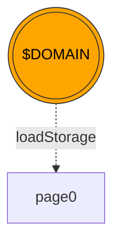
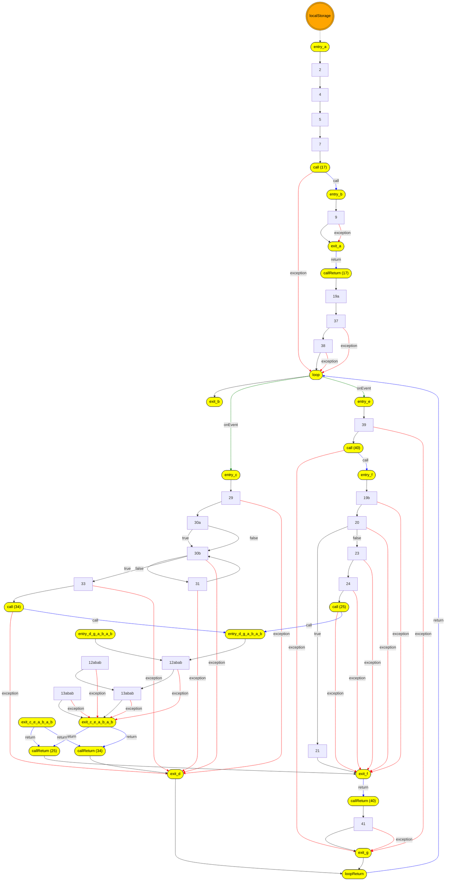

# `inter-page`

## Hierarchy

## Graph

## Def-use pairs

| Variable | Def-Use pairs |
| --- | --- |
| `window` | `(entry_a,37)` |
| `document` | `(entry_a,call (17))` `(entry_a,38)` `(entry_a,39)` |
| `String` |  |
| `Number` |  |
| `Boolean` |  |
| `Array` |  |
| `Map` |  |
| `WeakMap` |  |
| `Set` |  |
| `Date` |  |
| `console` |  |
| `init` | `(entry_a,37)` |
| `Math` | `(entry_a,31)` |
| `loadTodos` | `(2,29)` |
| `saveTodos` | `(2,24)` |
| `state` | `(4,33)` `(4,call (34))` `(4,23)` `(4,24)` `(4,call (25))` |
| `nextId` | `(31,31)` `(5,31)` `(5,23)` `(31,23)` |
| `TodoList` | `(7,call (17))` |
| `TodoList` |  |
| `root` | `(entry_b,9)` |
| `list` | `(call (17),call (34))` `(call (17),call (25))` |
| `addTodo` | `(19a,call (40))` |
| `saved` | `(29,(30a,30b))` `(29,(30a,30b))` `(29,33)` |
| `id` | `(30b,31)` |
| `title` | `(19b,(20,21))` `(19b,(20,23))` `(19b,23)` |
| `todos` | `(entry_d_g_a_b_a_b,12abab)` `(entry_d_g_a_b_a_b,12abab)` |
| `visible` | `(12abab,13abab)` `(12abab,13abab)` |
| `input` | `(39,call (40))` `(39,41)` |
