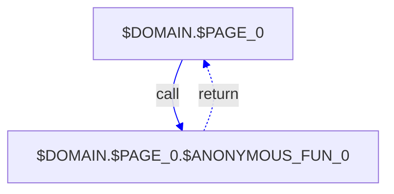
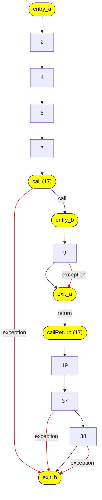

# `inter-procedural: $DOMAIN.$PAGE_0`

## Hierarchy

## Graph

## Def-use pairs

| Variable | Def-Use pairs |
| --- | --- |
| `window` | `(entry_a,37)` |
| `document` | `(entry_a,call (17))` `(entry_a,38)` |
| `String` |  |
| `Number` |  |
| `Boolean` |  |
| `Array` |  |
| `Map` |  |
| `WeakMap` |  |
| `Set` |  |
| `Date` |  |
| `console` |  |
| `init` | `(entry_a,37)` |
| `Math` |  |
| `loadTodos` |  |
| `saveTodos` |  |
| `state` |  |
| `nextId` |  |
| `TodoList` | `(7,call (17))` |
| `TodoList` |  |
| `root` | `(entry_b,9)` |
| `list` |  |
| `addTodo` |  |
