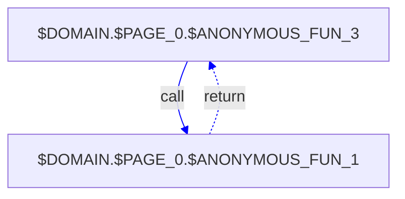
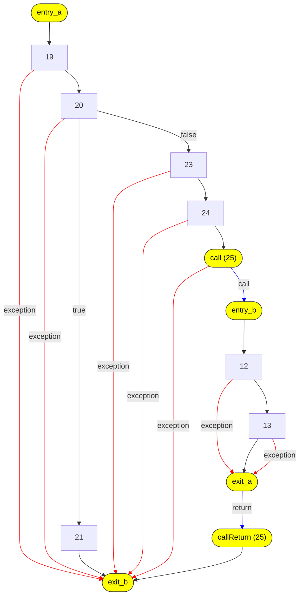

# `inter-procedural: $DOMAIN.$PAGE_0.$ANONYMOUS_FUN_3`

## Hierarchy

## Graph

## Def-use pairs

| Variable | Def-Use pairs |
| --- | --- |
| `title` | `(19,(20,21))` `(19,(20,23))` `(19,23)` |
| `todos` | `(entry_b,12)` |
| `visible` | `(12,13)` |
