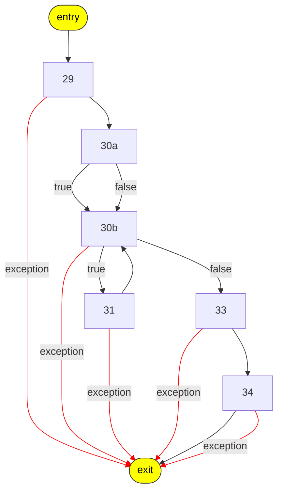

# `intra-procedural: $DOMAIN.$PAGE_0.init`

## Graph

## Def-use pairs

| Variable | Def-Use pairs |
| --- | --- |
| `saved` | `(29,(30a,30b))` `(29,(30a,30b))` `(29,33)` |
| `id` | `(30b,31)` |
| `nextId` | `(31,31)` |
