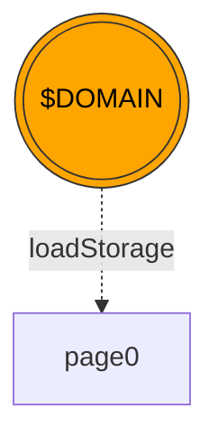

# `inter-page`

## Hierarchy

## Graph

```mermaid
flowchart TD
  n163((("localStorage")))
  n164(["entry_a"])
  n165["2"]
  n166["3"]
  n167["4"]
  n168(["call (9)"])
  n169(["entry_b"])
  n170["7"]
  n171(["exit_a"])
  n172(["callReturn (9)"])
  n173["10"]
  n174(["call (11)_a"])
  n175(["entry_c"])
  n176["12"]
  n177(["exit_b"])
  n178(["call (11)_b"])
  n179(["entry_d"])
  n180["14"]
  n181(["exit_c"])
  n182(["callReturn (11)"])
  n183(["call (36)_a"])
  n184(["entry_e"])
  n185["16"]
  n186(["exit_d"])
  n187(["call (36)_b"])
  n188(["entry_f"])
  n189["18"]
  n190(["exit_e"])
  n191(["call (36)_c"])
  n192(["entry_g"])
  n193["21"]
  n194(["call (22)"])
  n195(["entry_h"])
  n196["26"]
  n197["27"]
  n198(["call (28)"])
  n199(["callReturn (28)"])
  n200(["exit_f"])
  n201["30"]
  n202(["callReturn (22)"])
  n203["23"]
  n204(["exit_g"])
  n205(["callReturn (36)"])
  n206(["call (37)_a"])
  n207(["call (37)_b"])
  n208(["callReturn (37)"])
  n209(["call (38)"])
  n210(["callReturn (38)"])
  n211(["call (39)"])
  n212(["entry_i"])
  n213["33"]
  n214(["exit_h"])
  n215(["callReturn (39)"])
  n216["42"]
  n217(["call (42#58;T)"])
  n218(["entry_j"])
  n219(["exit_i"])
  n220(["callReturn (42#58;T)"])
  n221(["call (51)"])
  n222(["entry_k"])
  n223["46"]
  n224["44"]
  n225["45"]
  n226["47"]
  n227(["call (49)"])
  n228(["entry_l"])
  n229["48"]
  n230(["exit_j"])
  n231(["callReturn (49)"])
  n232(["exit_k"])
  n233(["callReturn (51)"])
  n234["52"]
  n235(["call (42#58;F)"])
  n236(["callReturn (42#58;F)"])
  n237(["loop"])
  n238(["exit_l"])
  n239(["loopReturn"])
  n163 -.-> n164
  n164 --> n165
  n165 --> n166
  n166 -->|"true"| n167
  n166 -->|"false"| n168
  n166 -->|"exception"| n237
  n167 --> n168
  n167 -->|"exception"| n237
  n168 -->|"exception"| n237
  n168 -->|"call"| n169
  n169 --> n170
  n170 --> n171
  n170 -->|"exception"| n171
  n171 -->|"return"| n172
  n172 --> n173
  n173 --> n174
  n173 -->|"exception"| n237
  n174 -->|"exception"| n237
  n174 -->|"call"| n175
  n175 --> n176
  n176 --> n177
  n177 -->|"return"| n178
  n178 -->|"call"| n179
  n179 --> n180
  n180 --> n181
  n180 -->|"exception"| n181
  n181 -->|"return"| n182
  n182 --> n183
  n183 -->|"exception"| n237
  n183 -->|"call"| n184
  n184 --> n185
  n185 --> n186
  n186 -->|"return"| n187
  n186 -->|"return"| n207
  n187 -->|"call"| n188
  n188 --> n189
  n189 --> n190
  n189 -->|"exception"| n190
  n190 -->|"return"| n191
  n190 -->|"return"| n208
  n191 -->|"exception"| n237
  n191 -->|"call"| n192
  n192 --> n193
  n193 --> n194
  n194 -->|"exception"| n204
  n194 -->|"call"| n195
  n195 --> n196
  n196 -->|"true"| n197
  n196 -->|"false"| n201
  n197 --> n198
  n197 -->|"exception"| n200
  n198 -->|"exception"| n200
  n198 -->|"call"| n192
  n199 --> n201
  n200 -->|"return"| n202
  n200 -->|"return"| n210
  n201 --> n200
  n201 -->|"exception"| n200
  n202 --> n203
  n203 --> n204
  n203 -->|"exception"| n204
  n204 -->|"return"| n199
  n204 -->|"return"| n205
  n205 --> n206
  n206 -->|"exception"| n237
  n206 -->|"call"| n184
  n207 -->|"call"| n188
  n208 --> n209
  n209 -->|"exception"| n237
  n209 -->|"call"| n195
  n210 --> n211
  n211 -->|"exception"| n237
  n211 -->|"call"| n212
  n212 --> n213
  n213 --> n214
  n213 -->|"exception"| n214
  n214 -->|"return"| n215
  n215 --> n216
  n216 -->|"true"| n217
  n216 -->|"false"| n235
  n217 -->|"exception"| n237
  n217 -->|"call"| n218
  n218 --> n219
  n219 -->|"return"| n220
  n219 -->|"return"| n236
  n220 --> n221
  n221 -->|"exception"| n237
  n221 -->|"call"| n222
  n222 --> n223
  n223 --> n224
  n224 --> n225
  n224 -->|"exception"| n232
  n225 --> n226
  n225 -->|"exception"| n232
  n226 --> n227
  n226 -->|"exception"| n232
  n227 -->|"exception"| n232
  n227 -->|"call"| n228
  n228 --> n229
  n229 --> n230
  n230 -->|"return"| n231
  n231 --> n232
  n232 -->|"return"| n233
  n233 --> n234
  n234 --> n237
  n234 -->|"exception"| n237
  n235 -->|"exception"| n237
  n235 -->|"call"| n218
  n236 --> n221
  n237 --> n238
  n237 -->|"onEvent"| n239
  n239 -->|"return"| n237
  classDef ellipse fill:#ffff00,stroke:#333,color:#000
  classDef storage fill:#ffa500,stroke:#333,color:#000
  class n164,n168,n169,n171,n172,n174,n175,n177,n178,n179,n181,n182,n183,n184,n186,n187,n188,n190,n191,n192,n194,n195,n198,n199,n200,n202,n204,n205,n206,n207,n208,n209,n210,n211,n212,n214,n215,n217,n218,n219,n220,n221,n222,n227,n228,n230,n231,n232,n233,n235,n236,n237,n238,n239 ellipse
  class n163 storage
  linkStyle 0 stroke-dasharray:2 2
  linkStyle 5,7,8,12,16,17,25,28,37,40,44,50,51,57,60,64,68,71,75,80,86,91,93,95,96,105,106 stroke:red
  linkStyle 9,13,18,21,22,26,29,32,33,34,38,39,41,45,52,54,55,61,62,65,66,69,72,76,81,83,84,87,97,100,102,107,111 stroke:blue
  linkStyle 110 stroke:green
```

## Def-use pairs

| Variable | Def-Use pairs |
| --- | --- |
| `window` |  |
| `document` |  |
| `String` |  |
| `Number` |  |
| `Boolean` |  |
| `Array` |  |
| `Map` |  |
| `WeakMap` |  |
| `Set` |  |
| `Date` |  |
| `console` | `(entry_a,52)` |
| `a` | `(2,(3,4))` `(2,(3,call (9)))` `(4,call (42:T))` `(2,call (42:T))` `(4,44)` `(2,44)` |
| `b` | `(2,(3,4))` `(2,(3,call (9)))` `(2,call (42:F))` |
| `c` | `(2,(3,4))` `(2,(3,call (9)))` `(2,(26,27))` `(2,(26,30))` `(27,(26,27))` `(27,(26,30))` `(2,(42,call (42:T)))` `(2,(42,call (42:F)))` `(27,(42,call (42:T)))` `(27,(42,call (42:F)))` |
| `x` | `(7,10)` `(7,16)` `(30,16)` `(33,52)` |
| `y` | `(23,52)` |
| `counter` | `(call (37)_a,call (38))` |
| `P` | `(entry_a,call (9))` |
| `log` | `(entry_a,call (42:T))` `(entry_a,call (42:F))` |
| `h` | `(entry_a,call (51))` |
| `v` | `(entry_b,7)` |
| `Counter` | `(call (11)_a,call (36)_a)` `(call (11)_a,call (37)_a)` `(call (11)_a,call (39))` |
| `Counter` | `(call (11)_a,12)` `(call (11)_a,14)` |
| `n` | `(entry_g,21)` |
| `t` | `(21,23)` |
| `value` |  |
| `p` | `(44,45)` |
| `q` | `(45,48)` |
| `g` | `(47,call (49))` |
