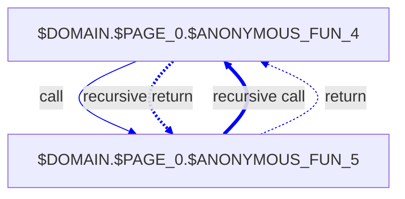
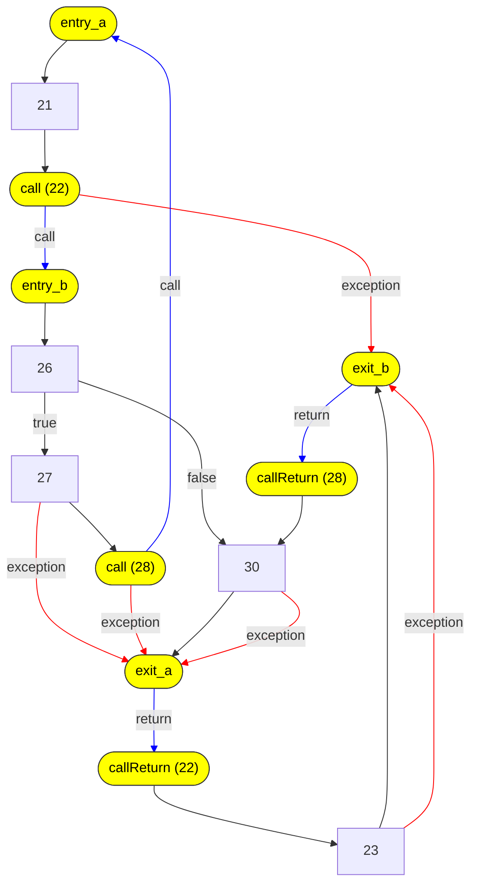

# `inter-procedural: $DOMAIN.$PAGE_0.$ANONYMOUS_FUN_4`

## Hierarchy

## Graph

## Def-use pairs

| Variable | Def-Use pairs |
| --- | --- |
| `c` | `(27,(26,27))` `(27,(26,30))` |
| `n` | `(entry_a,21)` |
| `t` | `(21,23)` |
| `x` |  |
| `y` |  |
