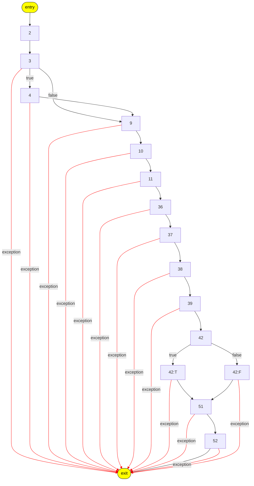

# `intra-procedural: $DOMAIN.$PAGE_0`

## Graph

## Def-use pairs

| Variable | Def-Use pairs |
| --- | --- |
| `window` |  |
| `document` |  |
| `String` |  |
| `Number` |  |
| `Boolean` |  |
| `Array` |  |
| `Map` |  |
| `WeakMap` |  |
| `Set` |  |
| `Date` |  |
| `console` | `(entry,52)` |
| `a` | `(2,(3,4))` `(2,(3,9))` `(4,42:T)` `(2,42:T)` |
| `b` | `(2,(3,4))` `(2,(3,9))` `(2,42:F)` |
| `c` | `(2,(3,4))` `(2,(3,9))` `(2,(42,42:T))` `(2,(42,42:F))` |
| `x` | `(2,10)` `(2,52)` |
| `y` | `(10,52)` |
| `counter` | `(37,38)` |
| `P` | `(entry,9)` |
| `log` | `(entry,42:T)` `(entry,42:F)` |
| `h` | `(entry,51)` |
| `Counter` | `(11,36)` `(11,37)` `(11,39)` |
| `Counter` |  |
