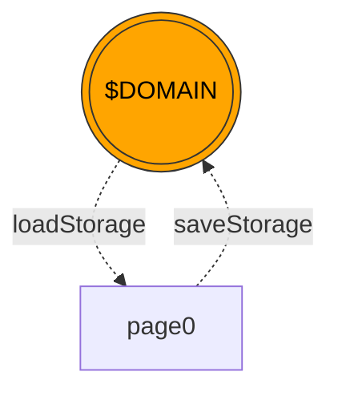

# `inter-page`

## Hierarchy

## Graph

```mermaid
flowchart TD
  n84((("localStorage")))
  n85(["entry_a"])
  n86["2"]
  n87["3"]
  n88(["call (15)"])
  n89(["entry_b"])
  n90["8"]
  n91(["call (9)"])
  n92(["entry_c"])
  n93["6"]
  n94(["exit_a"])
  n95(["callReturn (9)"])
  n96["10"]
  n97(["exit_b"])
  n98(["callReturn (15)"])
  n99(["call (16)"])
  n100(["entry_d"])
  n101["13"]
  n102(["exit_c"])
  n103(["callReturn (16)"])
  n104["16"]
  n105["17"]
  n106["28"]
  n107["29"]
  n108["30"]
  n109(["loop"])
  n110(["exit_d"])
  n111(["entry_e"])
  n112(["call (23)"])
  n113(["entry_f"])
  n114["21"]
  n115(["exit_e"])
  n116(["callReturn (23)"])
  n117(["exit_f"])
  n118(["loopReturn"])
  n119(["entry_g"])
  n120["26"]
  n121(["exit_g"])
  n84 -.-> n85
  n85 --> n86
  n86 --> n87
  n87 --> n88
  n88 -->|"exception"| n109
  n88 -->|"call"| n89
  n89 --> n90
  n90 --> n91
  n90 -->|"exception"| n97
  n91 -->|"exception"| n97
  n91 -->|"call"| n92
  n92 --> n93
  n93 --> n94
  n93 -->|"exception"| n94
  n94 -->|"return"| n95
  n95 --> n96
  n96 --> n97
  n97 -->|"return"| n98
  n98 --> n99
  n99 -->|"exception"| n109
  n99 -->|"call"| n100
  n100 --> n101
  n101 --> n102
  n101 -->|"exception"| n102
  n102 -->|"return"| n103
  n103 --> n104
  n104 -->|"true"| n105
  n104 -->|"false"| n106
  n105 --> n106
  n105 -->|"exception"| n109
  n106 --> n107
  n106 -->|"exception"| n109
  n107 --> n108
  n107 -->|"exception"| n109
  n108 --> n109
  n108 -->|"exception"| n109
  n108 -.-> n84
  n109 --> n110
  n109 -->|"onEvent"| n111
  n109 -->|"onEvent"| n119
  n111 --> n112
  n112 -->|"exception"| n117
  n112 -->|"call"| n113
  n113 --> n114
  n114 --> n115
  n114 -->|"exception"| n115
  n115 -->|"return"| n116
  n116 --> n117
  n117 --> n118
  n118 -->|"return"| n109
  n119 --> n120
  n120 --> n121
  n120 -->|"exception"| n121
  n121 --> n118
  classDef ellipse fill:#ffff00,stroke:#333,color:#000
  classDef storage fill:#ffa500,stroke:#333,color:#000
  class n85,n88,n89,n91,n92,n94,n95,n97,n98,n99,n100,n102,n103,n109,n110,n111,n112,n113,n115,n116,n117,n118,n119,n121 ellipse
  class n84 storage
  linkStyle 0,36 stroke-dasharray:2 2
  linkStyle 4,8,9,13,19,23,29,31,33,35,41,45,52 stroke:red
  linkStyle 5,10,14,17,20,24,42,46,49 stroke:blue
  linkStyle 38,39 stroke:green
```

## Def-use pairs

| Variable | Def-Use pairs |
| --- | --- |
| `window` | `(entry_a,28)` `(entry_a,29)` |
| `document` |  |
| `String` |  |
| `Number` |  |
| `Boolean` |  |
| `Array` |  |
| `Map` |  |
| `WeakMap` |  |
| `Set` |  |
| `Date` |  |
| `console` | `(entry_a,21)` |
| `addTo` | `(entry_a,call (15))` |
| `isReady` | `(entry_a,(16,17))` `(entry_a,(16,28))` |
| `onClick` | `(entry_a,28)` |
| `onLoad` | `(entry_a,29)` |
| `limit` | `(3,13)` |
| `total` | `(2,8)` `(8,10)` `(8,13)` `(17,30)` `(8,30)` `(2,21)` `(8,21)` `(17,21)` |
| `localStorage` |  |
| `value` | `(entry_b,8)` `(entry_b,6)` |
| `scale` | `(entry_b,call (9))` |
| `log` | `(entry_e,call (23))` |
