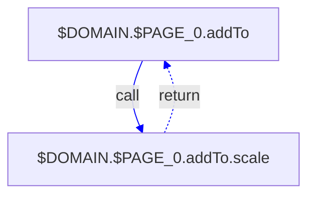
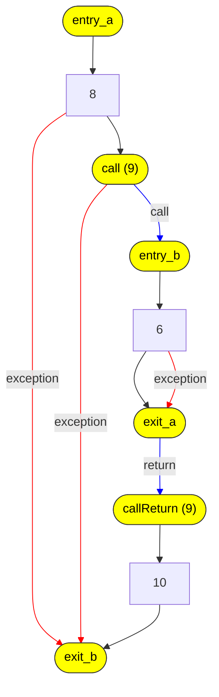

# `inter-procedural: $DOMAIN.$PAGE_0.addTo`

## Hierarchy

## Graph

## Def-use pairs

| Variable | Def-Use pairs |
| --- | --- |
| `value` | `(entry_a,8)` `(entry_a,6)` |
| `scale` | `(entry_a,call (9))` |
| `total` | `(8,10)` |
