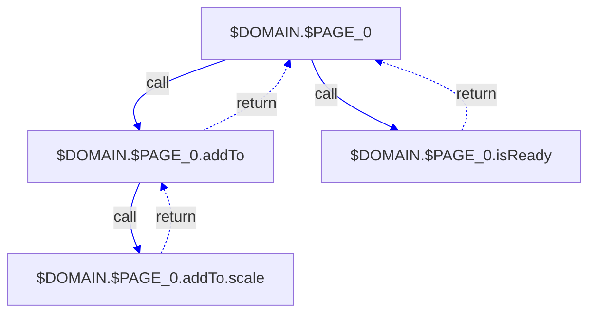
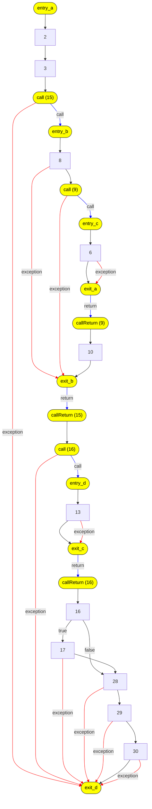

# `inter-procedural: $DOMAIN.$PAGE_0`

## Hierarchy

## Graph

## Def-use pairs

| Variable | Def-Use pairs |
| --- | --- |
| `window` | `(entry_a,28)` `(entry_a,29)` |
| `document` |  |
| `String` |  |
| `Number` |  |
| `Boolean` |  |
| `Array` |  |
| `Map` |  |
| `WeakMap` |  |
| `Set` |  |
| `Date` |  |
| `console` |  |
| `total` | `(2,8)` `(8,10)` `(8,13)` `(17,30)` `(8,30)` |
| `limit` | `(3,13)` |
| `addTo` | `(entry_a,call (15))` |
| `isReady` | `(entry_a,(16,17))` `(entry_a,(16,28))` |
| `onClick` | `(entry_a,28)` |
| `onLoad` | `(entry_a,29)` |
| `value` | `(entry_b,8)` `(entry_b,6)` |
| `scale` | `(entry_b,call (9))` |
| `localStorage` |  |
