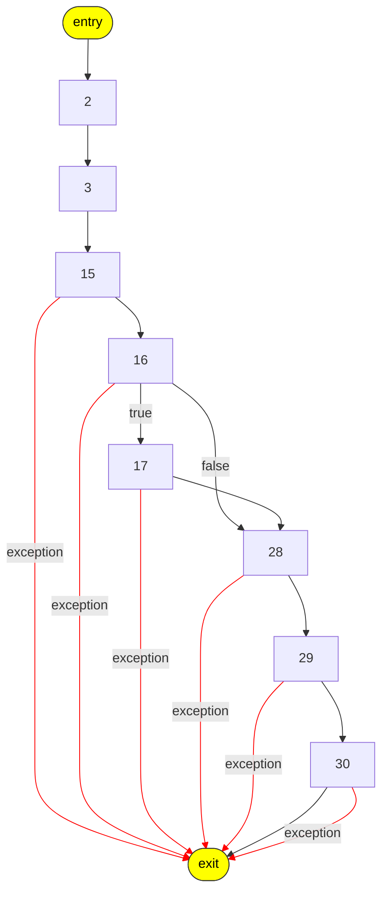

# `intra-procedural: $DOMAIN.$PAGE_0`

## Graph

## Def-use pairs

| Variable | Def-Use pairs |
| --- | --- |
| `window` | `(entry,28)` `(entry,29)` |
| `document` |  |
| `String` |  |
| `Number` |  |
| `Boolean` |  |
| `Array` |  |
| `Map` |  |
| `WeakMap` |  |
| `Set` |  |
| `Date` |  |
| `console` |  |
| `total` | `(17,30)` `(2,30)` |
| `limit` |  |
| `addTo` | `(entry,15)` |
| `isReady` | `(entry,(16,17))` `(entry,(16,28))` |
| `onClick` | `(entry,28)` |
| `onLoad` | `(entry,29)` |
| `localStorage` |  |
