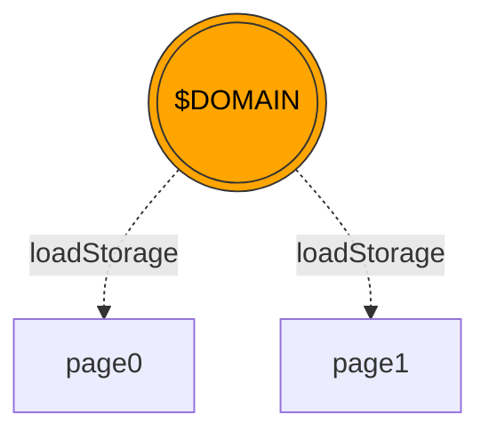
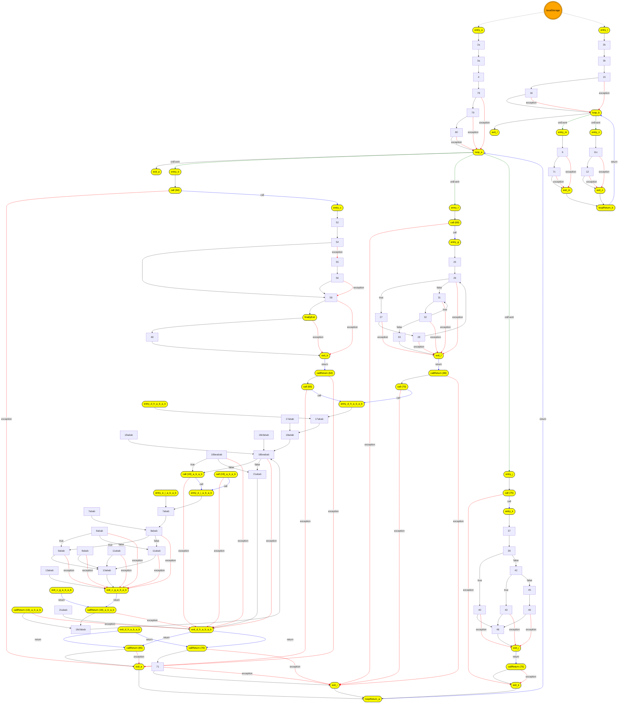

# `inter-page`

## Hierarchy

## Graph

## Def-use pairs

| Variable | Def-Use pairs |
| --- | --- |
| `window` | `(entry_a,78)` |
| `document` | `(entry_a,79)` `(entry_a,80)` |
| `String` |  |
| `Number` |  |
| `Boolean` |  |
| `Array` |  |
| `Map` |  |
| `WeakMap` |  |
| `Set` |  |
| `Date` |  |
| `console` |  |
| `total` |  |
| `items` | `(call (64),call (65))` `(3a,call (69))` `(call (64),call (69))` `(3a,call (70))` `(call (64),call (70))` `(3a,71)` `(call (64),71)` |
| `mode` | `(4,call (75))` `(call (75),call (75))` |
| `add` | `(entry_a,call (19)_a_b_a_b)` `(entry_a,call (19)_a_b_a_b)` |
| `sumAll` | `(entry_a,call (65))` `(entry_a,call (70))` |
| `countDown` | `(entry_a,call (69))` |
| `describeMode` | `(entry_a,call (75))` |
| `parseSaved` | `(entry_a,call (64))` |
| `onLoad` | `(entry_a,78)` |
| `onAdd` | `(entry_a,79)` |
| `onModeChange` | `(entry_a,80)` |
| `JSON` | `(entry_a,54)` `(entry_a,71)` |
| `raw` | `(entry_c,54)` |
| `parsed` | `(54,60)` `(56,60)` `(52,60)` |
| `e` |  |
| `list` | `(entry_d_h_a_b_a_b,(18beabab,call (19)_a_b_a_b))` `(entry_d_h_a_b_a_b,(18beabab,21abab))` `(entry_d_h_a_b_a_b,call (19)_a_b_a_b)` `(entry_d_h_a_b_a_b,(18beabab,call (19)_a_b_a_b))` `(entry_d_h_a_b_a_b,(18beabab,21abab))` `(entry_d_h_a_b_a_b,call (19)_a_b_a_b)` |
| `sum` | `(call (19)_a_b_a_b,call (19)_a_b_a_b)` `(17abab,call (19)_a_b_a_b)` `(call (19)_a_b_a_b,21abab)` `(17abab,21abab)` `(call (19)_a_b_a_b,call (19)_a_b_a_b)` `(17abab,call (19)_a_b_a_b)` `(call (19)_a_b_a_b,21abab)` `(17abab,21abab)` |
| `i` | `(18cfabab,(18beabab,call (19)_a_b_a_b))` `(18cfabab,(18beabab,21abab))` `(18adab,(18beabab,call (19)_a_b_a_b))` `(18adab,(18beabab,21abab))` `(18cfabab,call (19)_a_b_a_b)` `(18adab,call (19)_a_b_a_b)` `(18cfabab,18cfabab)` `(18adab,18cfabab)` `(18cfabab,(18beabab,call (19)_a_b_a_b))` `(18cfabab,(18beabab,21abab))` `(18adab,(18beabab,call (19)_a_b_a_b))` `(18adab,(18beabab,21abab))` `(18cfabab,call (19)_a_b_a_b)` `(18adab,call (19)_a_b_a_b)` `(18cfabab,18cfabab)` `(18adab,18cfabab)` |
| `value` | `(entry_e_i_a_b_a_b,(8abab,9abab))` `(entry_e_i_a_b_a_b,(8abab,11abab))` `(entry_e_i_a_b_a_b,9abab)` `(entry_e_i_a_b_a_b,11abab)` `(entry_e_i_a_b_a_b,(8abab,9abab))` `(entry_e_i_a_b_a_b,(8abab,11abab))` `(entry_e_i_a_b_a_b,9abab)` `(entry_e_i_a_b_a_b,11abab)` |
| `result` | `(9abab,13abab)` `(11abab,13abab)` `(9abab,13abab)` `(11abab,13abab)` |
| `n` | `(entry_g,(26,27))` `(entry_g,(26,31))` `(27,(26,27))` `(27,(26,31))` `(entry_g,27)` `(27,27)` |
| `steps` | `(25,28)` `(28,28)` `(25,31)` `(28,31)` `(31,31)` `(31,(32,31))` `(31,(32,33))` `(31,33)` |
| `m` | `(entry_k,(39,40))` `(entry_k,(39,42))` `(entry_k,(42,43))` `(entry_k,(42,45))` |
| `text` | `(40,48)` `(43,48)` `(46,48)` |
| `window` | `(entry_l,15)` |
| `document` | `(entry_l,16)` |
| `String` |  |
| `Number` |  |
| `Boolean` |  |
| `Array` |  |
| `Map` |  |
| `WeakMap` |  |
| `Set` |  |
| `Date` |  |
| `console` |  |
| `saved` | `(6,7c)` |
| `count` |  |
| `onLoad` | `(entry_l,15)` |
| `onClear` | `(entry_l,16)` |
| `JSON` | `(entry_l,6)` |
