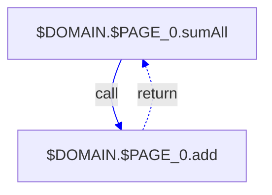
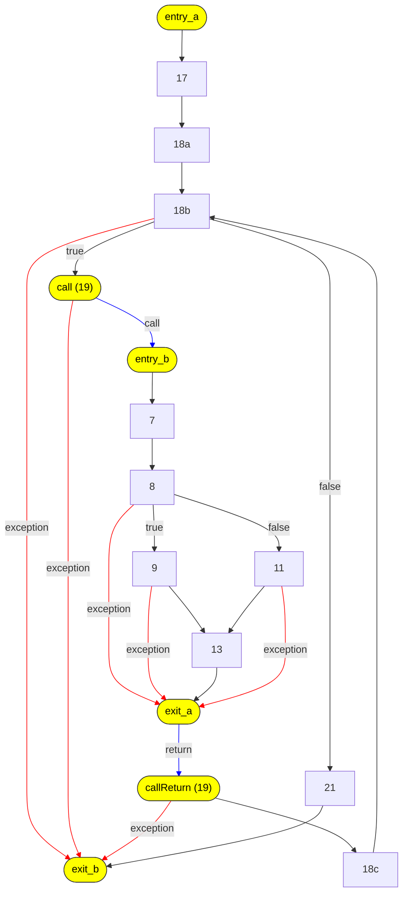

# `inter-procedural: $DOMAIN.$PAGE_0.sumAll`

## Hierarchy

## Graph

## Def-use pairs

| Variable | Def-Use pairs |
| --- | --- |
| `list` | `(entry_a,(18b,call (19)))` `(entry_a,(18b,21))` `(entry_a,call (19))` |
| `sum` | `(call (19),call (19))` `(17,call (19))` `(call (19),21)` `(17,21)` |
| `i` | `(18c,(18b,call (19)))` `(18c,(18b,21))` `(18a,(18b,call (19)))` `(18a,(18b,21))` `(18c,call (19))` `(18a,call (19))` `(18c,18c)` `(18a,18c)` |
| `value` | `(entry_b,(8,9))` `(entry_b,(8,11))` `(entry_b,9)` `(entry_b,11)` |
| `result` | `(9,13)` `(11,13)` |
