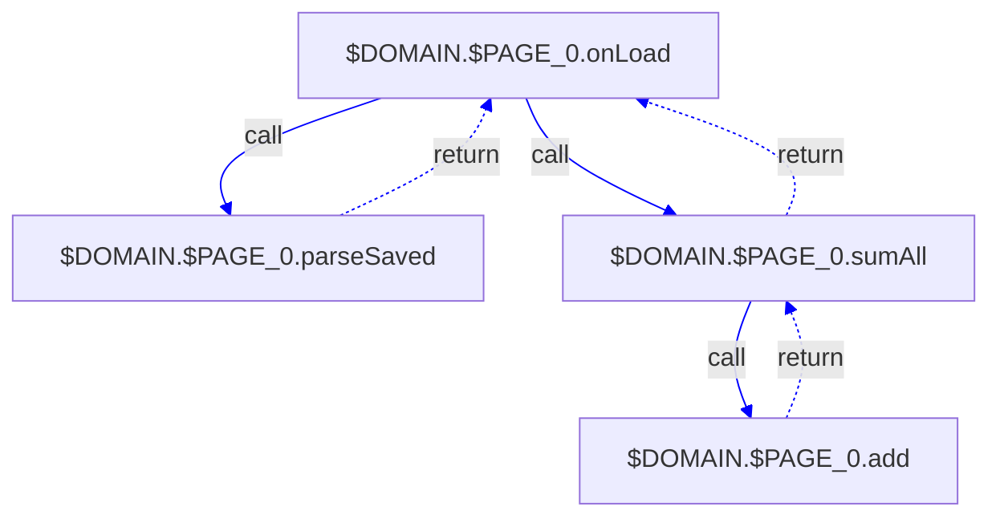
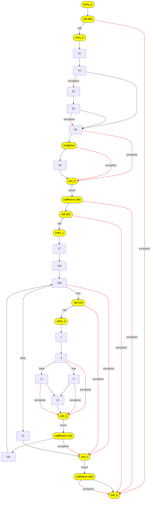

# `inter-procedural: $DOMAIN.$PAGE_0.onLoad`

## Hierarchy

## Graph

## Def-use pairs

| Variable | Def-Use pairs |
| --- | --- |
| `raw` | `(entry_b,54)` |
| `parsed` | `(54,60)` `(56,60)` `(52,60)` |
| `e` |  |
| `total` |  |
| `items` | `(call (64),call (65))` |
| `list` | `(entry_c,(18b,call (19)))` `(entry_c,(18b,21))` `(entry_c,call (19))` |
| `sum` | `(call (19),call (19))` `(17,call (19))` `(call (19),21)` `(17,21)` |
| `i` | `(18c,(18b,call (19)))` `(18c,(18b,21))` `(18a,(18b,call (19)))` `(18a,(18b,21))` `(18c,call (19))` `(18a,call (19))` `(18c,18c)` `(18a,18c)` |
| `value` | `(entry_d,(8,9))` `(entry_d,(8,11))` `(entry_d,9)` `(entry_d,11)` |
| `result` | `(9,13)` `(11,13)` |
