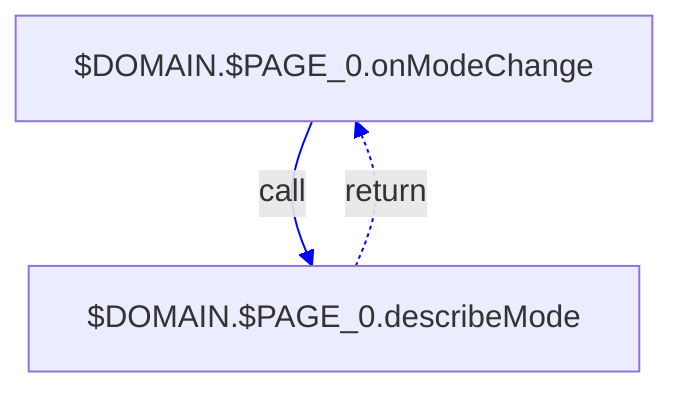
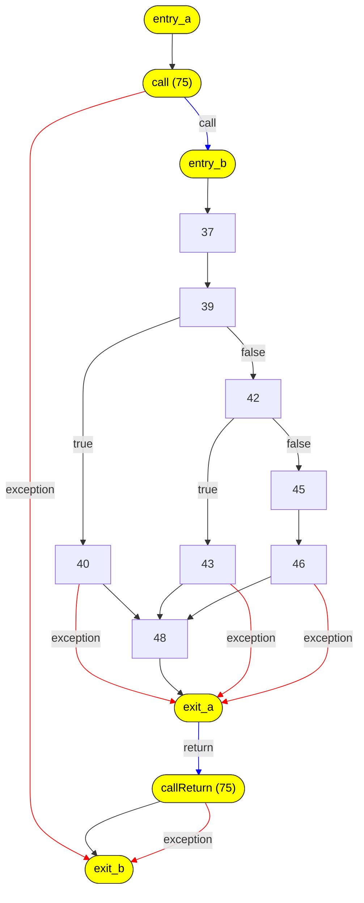

# `inter-procedural: $DOMAIN.$PAGE_0.onModeChange`

## Hierarchy

## Graph

## Def-use pairs

| Variable | Def-Use pairs |
| --- | --- |
| `m` | `(entry_b,(39,40))` `(entry_b,(39,42))` `(entry_b,(42,43))` `(entry_b,(42,45))` |
| `text` | `(40,48)` `(43,48)` `(46,48)` |
| `mode` |  |
