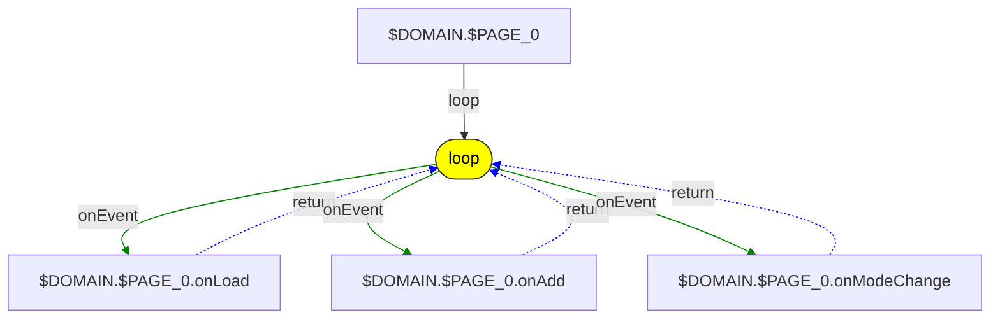

# `intra-page: $DOMAIN.$PAGE_0`

## Hierarchy



## Graph

```mermaid
flowchart TD
  n25(["entry_a"])
  n26["2"]
  n27["3"]
  n28["4"]
  n29["78"]
  n30["79"]
  n31["80"]
  n32(["loop"])
  n33(["exit_a"])
  n34(["entry_b"])
  n35(["call (64)"])
  n36(["entry_c"])
  n37["52"]
  n38["54"]
  n39["58"]
  n40(["finallyExit"])
  n41["60"]
  n42(["exit_b"])
  n43["55"]
  n44["56"]
  n45(["callReturn (64)"])
  n46(["call (65)"])
  n47(["entry_d_h_a_b_a_b"])
  n48["17abab"]
  n49["18adab"]
  n50["18beabab"]
  n51(["call (19)_a_b_a_b"])
  n52(["entry_e_i_a_b_a_b"])
  n53["7abab"]
  n54["8abab"]
  n55["9abab"]
  n56["13abab"]
  n57["11abab"]
  n58(["exit_c_g_a_b_a_b"])
  n59(["callReturn (19)_a_b_a_b"])
  n60["18cfabab"]
  n61["21abab"]
  n62(["exit_d_h_a_b_a_b"])
  n63(["callReturn (65)"])
  n64(["exit_e"])
  n65(["loopReturn"])
  n66(["entry_f"])
  n67(["call (69)"])
  n68(["entry_g"])
  n69["25"]
  n70["26"]
  n71["27"]
  n72["28"]
  n73["31"]
  n74["32"]
  n75["33"]
  n76(["exit_f"])
  n77(["callReturn (69)"])
  n78(["call (70)"])
  n79(["entry_d_h_a_b_a_b"])
  n80["17abab"]
  n81["18adab"]
  n82["18beabab"]
  n83(["call (19)_a_b_a_b"])
  n84(["entry_e_i_a_b_a_b"])
  n85["7abab"]
  n86["8abab"]
  n87["9abab"]
  n88["13abab"]
  n89["11abab"]
  n90(["exit_c_g_a_b_a_b"])
  n91(["callReturn (19)_a_b_a_b"])
  n92["18cfabab"]
  n93["21abab"]
  n94(["exit_d_h_a_b_a_b"])
  n95(["callReturn (70)"])
  n96["71"]
  n97(["exit_i"])
  n98(["entry_j"])
  n99(["call (75)"])
  n100(["entry_k"])
  n101["37"]
  n102["39"]
  n103["40"]
  n104["48"]
  n105(["exit_j"])
  n106["42"]
  n107["43"]
  n108["45"]
  n109["46"]
  n110(["callReturn (75)"])
  n111(["exit_k"])
  n25 --> n26
  n26 --> n27
  n27 --> n28
  n28 --> n29
  n29 --> n30
  n29 -->|"exception"| n32
  n30 --> n31
  n30 -->|"exception"| n32
  n31 --> n32
  n31 -->|"exception"| n32
  n32 --> n33
  n32 -->|"onEvent"| n34
  n32 -->|"onEvent"| n66
  n32 -->|"onEvent"| n98
  n34 --> n35
  n35 -->|"exception"| n64
  n35 -->|"call"| n36
  n36 --> n37
  n37 --> n38
  n38 --> n39
  n38 -->|"exception"| n43
  n39 --> n40
  n39 -->|"exception"| n42
  n40 --> n41
  n40 -->|"exception"| n42
  n41 --> n42
  n42 -->|"return"| n45
  n43 --> n44
  n44 --> n39
  n44 -->|"exception"| n39
  n45 --> n46
  n45 -->|"exception"| n64
  n46 -->|"exception"| n64
  n46 -->|"call"| n47
  n47 --> n48
  n48 --> n49
  n49 --> n50
  n50 -->|"true"| n51
  n50 -->|"false"| n61
  n50 -->|"exception"| n62
  n51 -->|"exception"| n62
  n51 -->|"call"| n52
  n52 --> n53
  n53 --> n54
  n54 -->|"true"| n55
  n54 -->|"false"| n57
  n54 -->|"exception"| n58
  n55 --> n56
  n55 -->|"exception"| n58
  n56 --> n58
  n57 --> n56
  n57 -->|"exception"| n58
  n58 -->|"return"| n59
  n59 --> n60
  n59 -->|"exception"| n62
  n60 --> n50
  n61 --> n62
  n62 -->|"return"| n63
  n62 -->|"return"| n95
  n63 --> n64
  n63 -->|"exception"| n64
  n64 --> n65
  n65 -->|"return"| n32
  n66 --> n67
  n67 -->|"exception"| n97
  n67 -->|"call"| n68
  n68 --> n69
  n69 --> n70
  n70 -->|"true"| n71
  n70 -->|"false"| n73
  n70 -->|"exception"| n76
  n71 --> n72
  n71 -->|"exception"| n76
  n72 --> n70
  n72 -->|"exception"| n76
  n73 --> n74
  n73 -->|"exception"| n76
  n74 -->|"true"| n73
  n74 -->|"false"| n75
  n74 -->|"exception"| n76
  n75 --> n76
  n76 -->|"return"| n77
  n77 --> n78
  n77 -->|"exception"| n97
  n78 -->|"exception"| n97
  n78 -->|"call"| n47
  n79 --> n48
  n80 --> n49
  n81 --> n50
  n82 -->|"true"| n51
  n82 -->|"false"| n61
  n82 -->|"exception"| n62
  n83 -->|"exception"| n62
  n83 -->|"call"| n52
  n84 --> n53
  n85 --> n54
  n86 -->|"true"| n55
  n86 -->|"false"| n57
  n86 -->|"exception"| n58
  n87 --> n56
  n87 -->|"exception"| n58
  n88 --> n58
  n89 --> n56
  n89 -->|"exception"| n58
  n90 -->|"return"| n59
  n91 --> n60
  n91 -->|"exception"| n62
  n92 --> n50
  n93 --> n62
  n94 -->|"return"| n63
  n94 -->|"return"| n95
  n95 --> n96
  n95 -->|"exception"| n97
  n96 --> n97
  n96 -->|"exception"| n97
  n97 --> n65
  n98 --> n99
  n99 -->|"exception"| n111
  n99 -->|"call"| n100
  n100 --> n101
  n101 --> n102
  n102 -->|"true"| n103
  n102 -->|"false"| n106
  n103 --> n104
  n103 -->|"exception"| n105
  n104 --> n105
  n105 -->|"return"| n110
  n106 -->|"true"| n107
  n106 -->|"false"| n108
  n107 --> n104
  n107 -->|"exception"| n105
  n108 --> n109
  n109 --> n104
  n109 -->|"exception"| n105
  n110 --> n111
  n110 -->|"exception"| n111
  n111 --> n65
  classDef ellipse fill:#ffff00,stroke:#333,color:#000
  class n25,n32,n33,n34,n35,n36,n40,n42,n45,n46,n47,n51,n52,n58,n59,n62,n63,n64,n65,n66,n67,n68,n76,n77,n78,n79,n83,n84,n90,n91,n94,n95,n97,n98,n99,n100,n105,n110,n111 ellipse
  linkStyle 5,7,9,15,20,22,24,29,31,32,39,40,46,48,51,54,60,64,70,72,74,76,79,83,84,91,92,98,100,103,106,112,114,117,124,130,133,135 stroke:red
  linkStyle 11,12,13 stroke:green
  linkStyle 16,26,33,41,52,57,58,62,65,81,85,93,104,109,110,118,126 stroke:blue
```

## Def-use pairs

| Variable | Def-Use pairs |
| --- | --- |
| `window` | `(entry_a,78)` |
| `document` | `(entry_a,79)`<br/>`(entry_a,80)` |
| `String` |  |
| `Number` |  |
| `Boolean` |  |
| `Array` |  |
| `Map` |  |
| `WeakMap` |  |
| `Set` |  |
| `Date` |  |
| `console` |  |
| `total` |  |
| `items` | `(call (64),call (65))`<br/>`(3,call (69))`<br/>`(call (64),call (69))`<br/>`(3,call (70))`<br/>`(call (64),call (70))`<br/>`(3,71)`<br/>`(call (64),71)` |
| `mode` | `(4,call (75))`<br/>`(call (75),call (75))` |
| `add` | `(entry_a,call (19)_a_b_a_b)`<br/>`(entry_a,call (19)_a_b_a_b)` |
| `sumAll` | `(entry_a,call (65))`<br/>`(entry_a,call (70))` |
| `countDown` | `(entry_a,call (69))` |
| `describeMode` | `(entry_a,call (75))` |
| `parseSaved` | `(entry_a,call (64))` |
| `onLoad` | `(entry_a,78)` |
| `onAdd` | `(entry_a,79)` |
| `onModeChange` | `(entry_a,80)` |
| `JSON` | `(entry_a,54)`<br/>`(entry_a,71)` |
| `raw` | `(entry_c,54)` |
| `parsed` | `(54,60)`<br/>`(56,60)`<br/>`(52,60)` |
| `e` |  |
| `list` | `(entry_d_h_a_b_a_b,(18beabab,call (19)_a_b_a_b))`<br/>`(entry_d_h_a_b_a_b,(18beabab,21abab))`<br/>`(entry_d_h_a_b_a_b,call (19)_a_b_a_b)`<br/>`(entry_d_h_a_b_a_b,(18beabab,call (19)_a_b_a_b))`<br/>`(entry_d_h_a_b_a_b,(18beabab,21abab))`<br/>`(entry_d_h_a_b_a_b,call (19)_a_b_a_b)` |
| `sum` | `(call (19)_a_b_a_b,call (19)_a_b_a_b)`<br/>`(17abab,call (19)_a_b_a_b)`<br/>`(call (19)_a_b_a_b,21abab)`<br/>`(17abab,21abab)`<br/>`(call (19)_a_b_a_b,call (19)_a_b_a_b)`<br/>`(17abab,call (19)_a_b_a_b)`<br/>`(call (19)_a_b_a_b,21abab)`<br/>`(17abab,21abab)` |
| `i` | `(18cfabab,(18beabab,call (19)_a_b_a_b))`<br/>`(18cfabab,(18beabab,21abab))`<br/>`(18adab,(18beabab,call (19)_a_b_a_b))`<br/>`(18adab,(18beabab,21abab))`<br/>`(18cfabab,call (19)_a_b_a_b)`<br/>`(18adab,call (19)_a_b_a_b)`<br/>`(18cfabab,18cfabab)`<br/>`(18adab,18cfabab)`<br/>`(18cfabab,(18beabab,call (19)_a_b_a_b))`<br/>`(18cfabab,(18beabab,21abab))`<br/>`(18adab,(18beabab,call (19)_a_b_a_b))`<br/>`(18adab,(18beabab,21abab))`<br/>`(18cfabab,call (19)_a_b_a_b)`<br/>`(18adab,call (19)_a_b_a_b)`<br/>`(18cfabab,18cfabab)`<br/>`(18adab,18cfabab)` |
| `value` | `(entry_e_i_a_b_a_b,(8abab,9abab))`<br/>`(entry_e_i_a_b_a_b,(8abab,11abab))`<br/>`(entry_e_i_a_b_a_b,9abab)`<br/>`(entry_e_i_a_b_a_b,11abab)`<br/>`(entry_e_i_a_b_a_b,(8abab,9abab))`<br/>`(entry_e_i_a_b_a_b,(8abab,11abab))`<br/>`(entry_e_i_a_b_a_b,9abab)`<br/>`(entry_e_i_a_b_a_b,11abab)` |
| `result` | `(9abab,13abab)`<br/>`(11abab,13abab)`<br/>`(9abab,13abab)`<br/>`(11abab,13abab)` |
| `n` | `(entry_g,(26,27))`<br/>`(entry_g,(26,31))`<br/>`(27,(26,27))`<br/>`(27,(26,31))`<br/>`(entry_g,27)`<br/>`(27,27)` |
| `steps` | `(25,28)`<br/>`(28,28)`<br/>`(25,31)`<br/>`(28,31)`<br/>`(31,31)`<br/>`(31,(32,31))`<br/>`(31,(32,33))`<br/>`(31,33)` |
| `m` | `(entry_k,(39,40))`<br/>`(entry_k,(39,42))`<br/>`(entry_k,(42,43))`<br/>`(entry_k,(42,45))` |
| `text` | `(40,48)`<br/>`(43,48)`<br/>`(46,48)` |
