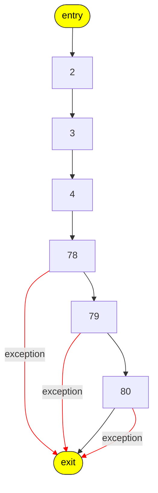

# `intra-procedural: $DOMAIN.$PAGE_0`

## Graph

## Def-use pairs

| Variable | Def-Use pairs |
| --- | --- |
| `window` | `(entry,78)` |
| `document` | `(entry,79)` `(entry,80)` |
| `String` |  |
| `Number` |  |
| `Boolean` |  |
| `Array` |  |
| `Map` |  |
| `WeakMap` |  |
| `Set` |  |
| `Date` |  |
| `console` |  |
| `total` |  |
| `items` |  |
| `mode` |  |
| `add` |  |
| `sumAll` |  |
| `countDown` |  |
| `describeMode` |  |
| `parseSaved` |  |
| `onLoad` | `(entry,78)` |
| `onAdd` | `(entry,79)` |
| `onModeChange` | `(entry,80)` |
| `JSON` |  |
