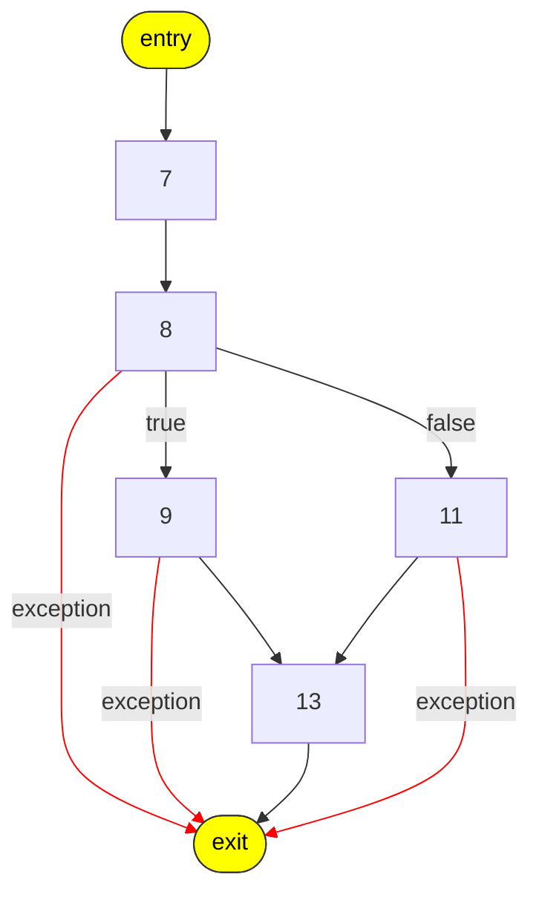

# `intra-procedural: $DOMAIN.$PAGE_0.add`

## Graph

## Def-use pairs

| Variable | Def-Use pairs |
| --- | --- |
| `value` | `(entry,(8,9))` `(entry,(8,11))` `(entry,9)` `(entry,11)` |
| `result` | `(9,13)` `(11,13)` |
