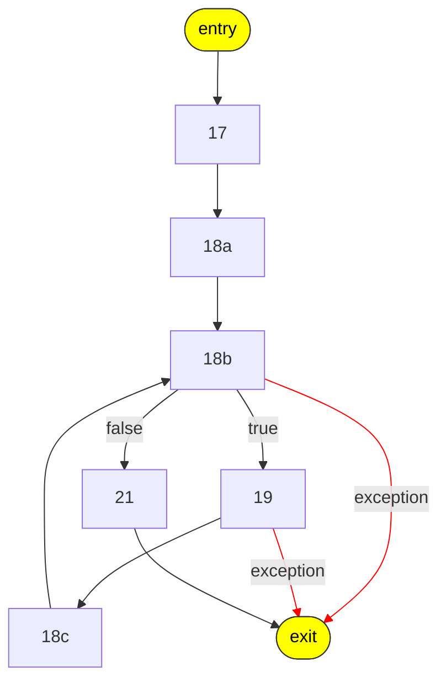

# `intra-procedural: $DOMAIN.$PAGE_0.sumAll`

## Graph

## Def-use pairs

| Variable | Def-Use pairs |
| --- | --- |
| `list` | `(entry,(18b,19))` `(entry,(18b,21))` `(entry,19)` |
| `sum` | `(19,19)` `(17,19)` `(19,21)` `(17,21)` |
| `i` | `(18c,(18b,19))` `(18c,(18b,21))` `(18a,(18b,19))` `(18a,(18b,21))` `(18c,19)` `(18a,19)` `(18c,18c)` `(18a,18c)` |
