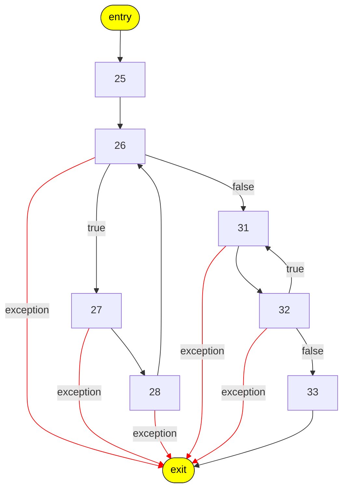

# `intra-procedural: $DOMAIN.$PAGE_0.countDown`

## Graph

## Def-use pairs

| Variable | Def-Use pairs |
| --- | --- |
| `n` | `(entry,(26,27))` `(entry,(26,31))` `(27,(26,27))` `(27,(26,31))` `(entry,27)` `(27,27)` |
| `steps` | `(25,28)` `(28,28)` `(25,31)` `(28,31)` `(31,31)` `(31,(32,31))` `(31,(32,33))` `(31,33)` |
