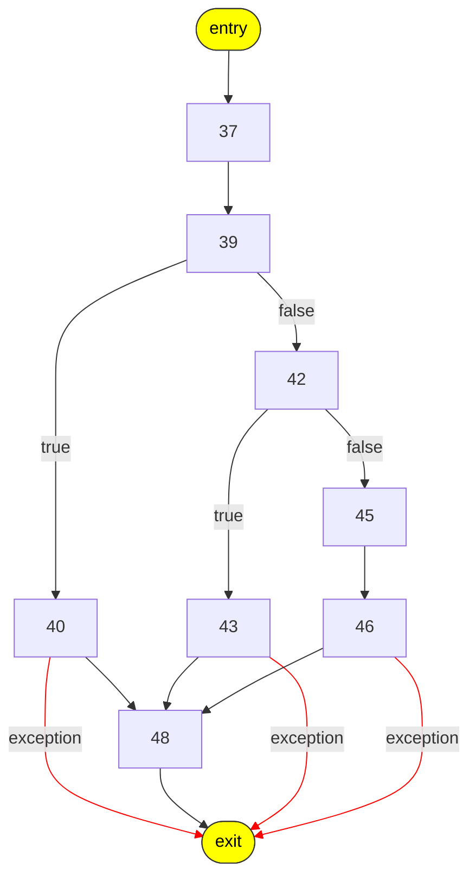

# `intra-procedural: $DOMAIN.$PAGE_0.describeMode`

## Graph

## Def-use pairs

| Variable | Def-Use pairs |
| --- | --- |
| `m` | `(entry,(39,40))` `(entry,(39,42))` `(entry,(42,43))` `(entry,(42,45))` |
| `text` | `(40,48)` `(43,48)` `(46,48)` |
