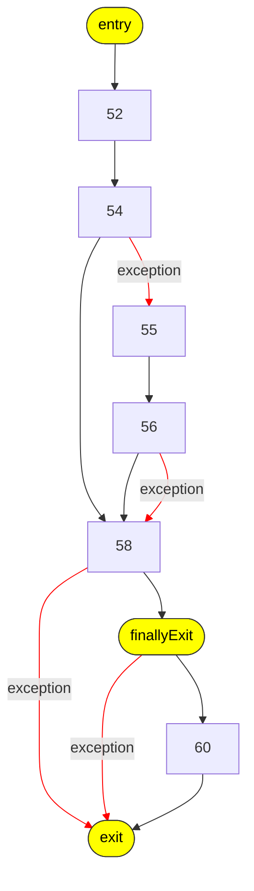

# `intra-procedural: $DOMAIN.$PAGE_0.parseSaved`

## Graph

## Def-use pairs

| Variable | Def-Use pairs |
| --- | --- |
| `raw` | `(entry,54)` |
| `parsed` | `(54,60)` `(56,60)` `(52,60)` |
| `e` |  |
| `total` |  |
