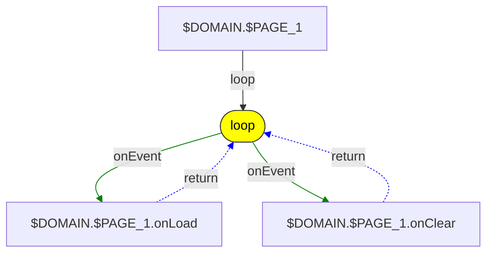
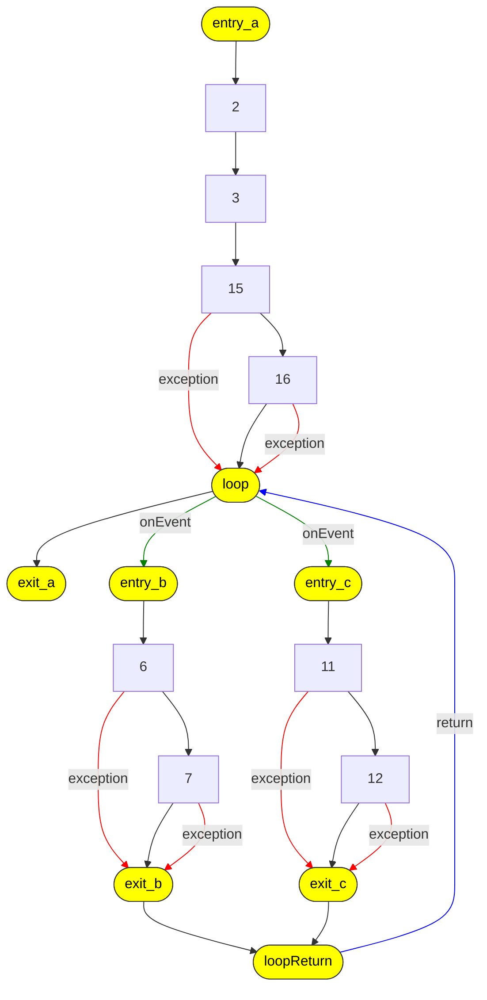

# `intra-page: $DOMAIN.$PAGE_1`

## Hierarchy

## Graph

## Def-use pairs

| Variable | Def-Use pairs |
| --- | --- |
| `window` | `(entry_a,15)` |
| `document` | `(entry_a,16)` |
| `String` |  |
| `Number` |  |
| `Boolean` |  |
| `Array` |  |
| `Map` |  |
| `WeakMap` |  |
| `Set` |  |
| `Date` |  |
| `console` |  |
| `saved` | `(6,7)` |
| `count` |  |
| `onLoad` | `(entry_a,15)` |
| `onClear` | `(entry_a,16)` |
| `JSON` | `(entry_a,6)` |
